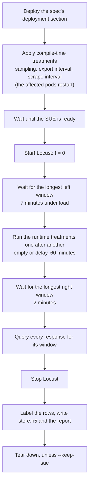

# Experiment design

The `recommendation_*` specs in `experiments/` go back to GOXN's evaluation. Each variant changes one part of the observability setup of the OpenTelemetry Demo and records what that change costs in CPU, energy, network traffic and storage. This page explains what the experiments compare, how a run is timed, and which variants to compare with each other.

[Experiments](experiments.md) covers the spec format and the `oxn` command. [Deployments](deployments.md) covers what each spec installs. The comment at the top of every spec summarizes that spec.

## The question

Observability has a price. Every span the collector keeps, every metric a service exports and every sample Prometheus scrapes costs CPU time, memory, network traffic and disk space, and with them energy. The experiments put a number on that price. They run the same SUE under the same load and change one observability setting at a time:

- How many traces the collector keeps
- How often the services export metrics
- How often the SUE's Prometheus scrapes
- Where Jaeger stores traces
- Whether a service mesh runs around the SUE

The fault spec adds a known fault on top of a configuration. Comparing its `fault=delay` variants with the `fault=none` variants of the same configuration shows how the fault appears in the data at that sampling rate or export interval. Checking whether an observability configuration still reveals a fault is the question OXN was originally built for.

## What gets measured

The diagram shows the SUE, the observability pipeline inside it, and the monitoring stack outside it that does the measuring. The numbers mark where each experiment factor acts. The table below the diagram explains them.

| Marker | Factor | How it is set | Levels in the shipped specs |
|---|---|---|---|
| (1) | Trace sampling | `kube_probl` treatment, sets the collector's probabilistic sampler | 0 %, 1 % (the default in the Helm values, only in the fault spec), 5 %, 10 %, 50 % |
| (2) | Metric export interval | `kubernetes_otel_metrics_interval` treatment, sets `OTEL_METRIC_EXPORT_INTERVAL` on a Deployment | 1 s, 30 s, 60 s (the SDK default) |
| (3) | Trace storage | Deployment setup: in-memory Jaeger, or Jaeger backed by Elasticsearch | In memory, Elasticsearch |
| (4) | Fault | `delay` treatment, `tc netem` on the recommendation pod | None, 45 ms ± 45 ms for 60 minutes |
| (5) | Scrape interval | `kubernetes_prometheus_interval` treatment, edits the `prometheus` ConfigMap and restarts Prometheus | 5 s, 30 s, 60 s (the chart default) |
| (6) | Service mesh | Deployment setup: Istio with sidecar injection on `system-under-evaluation` | None, Istio 1.30.7 |

**Why two Prometheus instances.**

- The SUE's own Prometheus is part of the observability setup under test. Its scrape interval is a factor, and its CPU and disk usage count toward the SUE. Responses read from it use `target: sue`.
- The external Prometheus in `oxn-external-monitoring` does the measuring. It scrapes cAdvisor through the kubelet, kube-state-metrics and Kepler. It lives outside the SUE's namespace, so its own cost does not count toward the SUE. Responses read from it use `target: oxn`.

**Locust counts toward the SUE.** Locust runs in `system-under-evaluation`. Responses that sum over the whole namespace, such as `system_CPU` or `kepler_joules_namespace_combined`, include the load generator. The per-container responses let you leave it out.

## One run, step by step

`oxn <spec>` does the following for each run. The [architecture](architecture.md) page follows the same steps through the code.

For the `recommendation_*` specs this gives the following timeline. The axis counts hours and minutes from the start of the response windows, 7 minutes before the load starts. The bar names give the times relative to the start of the load (t = 0). The compile-time bar starts at 00:05 only as an example, because its real start depends on how long the deployment takes.

```mermaid
gantt
    dateFormat HH:mm
    axisFormat %H:%M
    tickInterval 10minute
    section Load
        Locust under load, t = 0 to 69 min                : 00:07, 01:16
    section Treatments
        Compile-time treatments, from before t = 0 to 67 min : 00:05, 01:14
        Wait for the left window, 0 to 7 min              : 00:07, 00:14
        Runtime treatment, empty or delay, 7 to 67 min    : active, 00:14, 01:14
        Right window, 67 to 69 min                        : 01:14, 01:16
    section Responses
        Most responses, -7 to 69 min                      : 00:00, 01:16
        all_namespaces responses, -0.5 to 67.5 min        : 00:06, 01:15
```

| Time since the load started | What happens |
|---|---|
| −7 min | Most response windows start. The load is not running yet. If deploying took less than 7 minutes, this part also covers the time before the SUE existed. |
| 0 | Locust starts and spawns 500 users at 50 per second, so all users run after 10 seconds |
| 0 to 7 min | `oxn` waits for the longest left window. The SUE runs under load with no runtime treatment. |
| 7 to 67 min | The runtime treatment runs: 60 minutes of `empty`, or 60 minutes of `delay` |
| 67 to 69 min | `oxn` waits for the longest right window |
| about 69 min | `oxn` queries all responses, then stops Locust. Locust's `run_time` of 70 minutes is only an upper limit. |

### Windows and labels

- **Windows.** A response covers the time from `left_window` before the load started until `right_window` after the last runtime treatment ended. The windows are not measured from each treatment. With `step: 30`, a metric response has one row every 30 seconds.
- **Labels.** Each treatment adds a column to every response, named after the treatment. Rows inside the treatment's time span get the treatment's name, all others get `NoTreatment`.
  - A runtime treatment spans exactly its 60 minutes, so its column separates the treated phase from the phases before and after it.
  - A compile-time treatment spans from its injection, before the load, until the runtime treatments end. Its column marks almost the whole run, so analyses should split the data by the runtime treatment's column.

## The specs and what to compare

The experiments are five specs, each with a [matrix](experiments.md#matrix). The variants of a spec share everything except their levels, so compare variants of the same spec with each other. `oxn plan <spec>` lists them.

| Spec | Axes and levels | Variants | Compare against |
|---|---|---|---|
| `recommendation_k8_sampling.yml` | `sampling`: 0.0, 5.0, 10.0, 50.0. `storage`: memory, elasticsearch | 8 | `sampling=0.0` of the same storage, `storage=memory` of the same rate |
| `recommendation_k8_metric_export.yml` | `export_interval`: 1s, 30s, 60s. `storage`: memory, elasticsearch | 6 | `export_interval=60s` of the same storage |
| `recommendation_k8_scrape_mesh.yml` | `scrape`: 5s, 30s, 60s. `mesh`: none, istio | 6 | `scrape=60s` of the same mesh, `mesh=none` of the same interval |
| `recommendation_k8_fault.yml` | `fault`: none, delay. `telemetry`: defaults, sampling_5, sampling_10, export_1s | 8 | `fault=none` of the same telemetry |
| `recommendation_k8_minimal.yml` | `telemetry`: sampling_10, sampling_50, export_1s | 3 | The matching variants of the other specs, for fewer responses |

Every variant deploys the SUE from scratch, runs a 60 minute runtime treatment under 70 minutes of load, and records the same responses as the other variants of its spec. A run of all five specs is 31 runs, about 36 hours of load. Each spec's header comment describes its axes.

### Trace sampling

`recommendation_k8_sampling.yml` sets the collector's probabilistic head sampler to the `sampling` share, with hash seed 22. `sampling=0.0` is the reference point: the collector drops every trace, so tracing costs only what the SDKs and the collector spend before sampling. The other levels show how the cost grows with the share of traces kept. `storage=elasticsearch` stores the kept traces in Elasticsearch, so comparing it with `storage=memory` at the same rate shows the cost of persisting traces. All variants set the SUE's Prometheus to scrape every 60 s with rule evaluation every 30 s.

### Metric export interval

`recommendation_k8_metric_export.yml` sets `OTEL_METRIC_EXPORT_INTERVAL` on all 18 instrumented services to the `export_interval`. 60 s is the SDK default and the reference point. Setting it explicitly restarts the same 18 pods in every variant, so the restarts do not differ between levels. More frequent exports mean more requests to the collector, more samples in the SUE's Prometheus, and more data on disk. `storage` is the same axis as in the sampling spec.

### Scrape interval

`recommendation_k8_scrape_mesh.yml` changes how often the SUE's Prometheus scrapes its targets: 5 s and 60 s with a 3 s timeout, 30 s with a 10 s timeout, and rule evaluation every 30 s. Traces go to Elasticsearch and the recommendation service exports metrics every 60 s. The response `prometheus_scrape_amount` counts the samples Prometheus ingests, so it shows the effect directly.

### Service mesh

`mesh=istio` in the same spec runs the SUE with an Envoy sidecar in every pod, from Istio 1.30.7 in `istio-system`. Comparing it with `mesh=none` at the same scrape interval gives the cost of the mesh. Istio also sends its own spans to the SUE's collector.

### Fault

`fault=delay` in `recommendation_k8_fault.yml` adds 45 ms ± 45 ms of latency on the recommendation pod for the 60 minutes of the runtime treatment, `fault=none` runs an empty treatment instead. The `telemetry` axis sets what the SUE observes:

| Level | Treatments before the load |
|---|---|
| `defaults` | None: 1 % sampling from the Helm values, metric export every 60 s |
| `sampling_5`, `sampling_10` | Head sampling at 5 % or 10 % |
| `export_1s` | Metric export every 1 s for the recommendation service |

Besides the usual responses, all variants record frontend and recommendation traces from Jaeger, up to 30000 traces each. The delay should show up in those spans and in `latency_frontend_95_percentile`. Comparing `fault=delay` with `fault=none` at the same telemetry level shows how the fault appears in the data, and comparing the levels shows how sampling or exporting metrics every 1 s changes what the data reveals.

### Minimal specs

`recommendation_k8_minimal.yml` records only three cumulative counters: container energy, network bytes sent and storage I/O of the SUE. Its storage response reads every device, not only `/dev/md2`. GOXN added these as "experiments with only the needed set of responses" (commit `931d465`). A cumulative counter gives the total for any period as its last value minus its first value. `export_1s` sets only the recommendation service to 1 s, not all 18 services as in the metric export spec.

### Where the comparisons are not exact

| Comparison | Difference besides the factor |
|---|---|
| Variants of different specs | They are not designed to be compared. `export_interval=60s,storage=elasticsearch` and `scrape=60s,mesh=none` run the same setup, except that the first sets all 18 services to 60 s and the second only the recommendation service. |
| `recommendation_k8_fault.yml` against the other specs | The fault spec does not set the scrape interval, and records the trace responses |
| `recommendation_k8_minimal.yml` against the other specs | Fewer responses, and `export_1s` only for the recommendation service |

Compile-time treatments restart the pods they change, so the restarts are part of each comparison too. Within a spec, all variants restart the same pods, except for the `telemetry` axes, whose levels set different treatments. Comparing only rows labelled with the runtime treatment leaves the restarts out.

### Specs before the matrix

Up to [change 22](changes/22-matrix-specs.md), every variant was its own file. Data in `store.h5` from that time is stored under the old file names, new data under the spec and variant:

| Old spec | Spec and variant now | Differs from the old spec |
|---|---|---|
| `recommendation_k8_base_0_percent.yml` | `recommendation_k8_sampling.yml[sampling=0.0,storage=memory]` | |
| `recommendation_k8_base_5_percent.yml` | `recommendation_k8_sampling.yml[sampling=5.0,storage=memory]` | Also sets the scrape interval |
| `recommendation_k8_base_10_percent.yml` | `recommendation_k8_sampling.yml[sampling=10.0,storage=memory]` | Also sets the scrape interval |
| `recommendation_k8_base_50_percent.yml` | `recommendation_k8_sampling.yml[sampling=50.0,storage=memory]` | Also sets the scrape interval |
| `recommendation_k8_base_{5,10,50}_percent_persistence.yml` | `recommendation_k8_sampling.yml[sampling=…,storage=elasticsearch]` | |
| `recommendation_k8_base_1s_otel.yml` | `recommendation_k8_metric_export.yml[export_interval=1s,storage=memory]` | |
| `recommendation_k8_base_30s_otel.yml` | `recommendation_k8_metric_export.yml[export_interval=30s,storage=memory]` | Also sets the scrape interval |
| `recommendation_k8_base_1m_otel.yml` | `recommendation_k8_metric_export.yml[export_interval=60s,storage=memory]` | Sets all 18 services to 60 s, not only recommendation |
| `recommendation_k8_base_1s_otel_persistence.yml` | `recommendation_k8_metric_export.yml[export_interval=1s,storage=elasticsearch]` | |
| `recommendation_k8_base_30s_otel_persistence.yml` | `recommendation_k8_metric_export.yml[export_interval=30s,storage=elasticsearch]` | Also sets the scrape interval |
| `recommendation_k8_base_1m_otel_persistence.yml` | `recommendation_k8_scrape_mesh.yml[scrape=60s,mesh=none]` | |
| `recommendation_k8_base_1m_otel_persistence_scrape_{5s,30s}.yml` | `recommendation_k8_scrape_mesh.yml[scrape=…,mesh=none]` | |
| `recommendation_k8_base_1m_otel_persistence_istio.yml` | `recommendation_k8_scrape_mesh.yml[scrape=60s,mesh=istio]` | Also records `sampling_rates` |
| `recommendation_k8_delay_5_percent.yml` | `recommendation_k8_fault.yml[fault=delay,telemetry=sampling_5]` | |
| `recommendation_k8_delay_10_percent.yml` | `recommendation_k8_fault.yml[fault=delay,telemetry=sampling_10]` | |
| `recommendation_k8_delay_1m_otel.yml` | `recommendation_k8_fault.yml[fault=delay,telemetry=defaults]` | |
| `recommendation_k8_delay_1s_otel.yml` | `recommendation_k8_fault.yml[fault=delay,telemetry=export_1s]` | |
| `recommendation_k8_base_{10,50}_percent_minimal.yml` | `recommendation_k8_minimal.yml[telemetry=sampling_{10,50}]` | |
| `recommendation_k8_base_1s_otel_minimal.yml` | `recommendation_k8_minimal.yml[telemetry=export_1s]` | |

## Responses

All responses are Prometheus range queries, except the trace responses. Rates are taken over 90 seconds, storage rates over 3 minutes. Most energy, network and storage responses also come in an `_absolute` version, which holds the cumulative counter: joules or bytes since the container started.

| Group | Responses | What they tell | Unit (rate version) |
|---|---|---|---|
| CPU | `system_CPU`, `recommendation_deployment_CPU` | CPU usage of the namespace and of the recommendation pod, from cAdvisor | CPU cores |
| Energy of the recommendation pod | `recommendation_kepler_package_joules`, `recommendation_kepler_dram_joules` | Kepler's estimate for the pod, CPU package and DRAM separately | watts |
| Energy per container | `pods_kepler_{package,dram}_joules_all`, `pods_kepler_joules_all` and their `_absolute` versions | Each SUE container, labelled with `container_name` and `container_namespace` | watts |
| Energy of the namespace | `kepler_{package,dram}_joules_namespace_combined`, `kepler_joules_namespace_combined`, `kepler_joules_total_namespace_combined` and their `_absolute` versions | The whole SUE, including Locust | watts |
| Energy with more labels | `kepler_metric_all_namespace`, `pods_kepler_joules_all_container_level` | Per container with pod and node, or with the pod's `app.kubernetes.io/name` label | watts or joules |
| Energy of all namespaces | `pods_kepler_*_absolute_all_namespaces`, `pods_kepler_joules_all_container_level_all_namespaces` | Every container on the cluster, including the monitoring stack, for comparison | joules |
| Network | `cadvisor_network_bytes_{transmitted,received}_*` | Bytes sent and received, per app label, per namespace, or for the recommendation pod | bytes per second |
| Storage | `cadvisor_storage_usage_*` | Bytes read from and written to `/dev/md2`, the disk of the ISE cluster node, per app label or per namespace. The `_writes_` response counts writes only. | bytes per second |
| Service level | `latency_frontend_95_percentile`, `recommendations_total` | 95th percentile of the frontend's outgoing request duration, and recommendations served in the last 3 minutes | seconds, count |
| Observability pipeline | `sampling_rates`, `prometheus_scrape_amount` | Traces the sampler kept and dropped (label `sampled`), and samples the SUE's Prometheus ingested | count |
| Traces | `frontend_traces`, `recommendation_traces` | Spans from Jaeger, only in `recommendation_k8_fault.yml` | one row per span |

In Kepler responses, "joules" without a zone means CPU package plus DRAM. Kepler 0.11 exports neither a total nor an "other" zone. The queries rebuild the label names of older Kepler versions, such as `container_namespace`, so the notebooks in `evaluation/` read the data of new runs too.

## Running the experiments

- **Cluster.** The specs are sized for the ISE cluster. They request about 35 GiB of memory, and the storage responses read the ISE node's disk. For a smaller cluster, see [Small clusters](deployments.md#small-clusters). Do not report numbers from such a run.
- **Repetitions.** Each spec describes one run, or one per variant of its [matrix](experiments.md#matrix). `--times N` repeats them in N rounds, each of which runs every variant once, with a fresh deployment and teardown for every run. Interleaving keeps slow changes of the cluster from favouring the variants that run first. `--randomize-variants` shuffles the variants in every round, `--randomize` only the treatments within a run. Separate specs still run one after the other.
- **Duration.** One run of a `recommendation_*` spec takes about 70 minutes of load, plus deployment and teardown. All five specs take about 36 hours of load. `oxn plan <spec> --times N` prints the load time of a spec and its variants.
