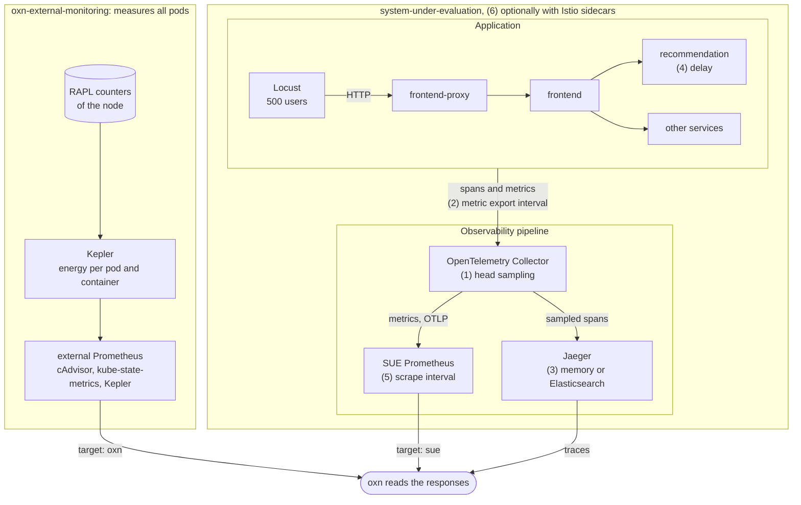
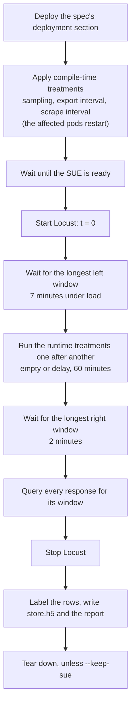
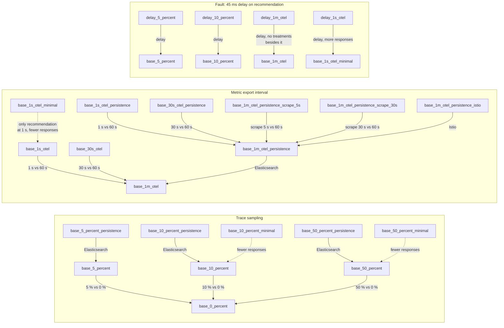

# Experiment design

The `recommendation_*` specs in `experiments/` were written for GOXN's evaluation. Each one changes one part of the observability setup of the OpenTelemetry Demo and records what that change costs in CPU, energy, network traffic and storage. This page explains what the experiments compare, how a run is timed, and which specs to compare with each other.

[Experiments](experiments.md) covers the spec format and the `oxn` command. [Deployments](deployments.md) covers what each spec installs. The comment at the top of every spec summarizes that spec.

## The question

Observability has a price. Every span the collector keeps, every metric a service exports and every sample Prometheus scrapes costs CPU time, memory, network traffic and disk space, and with them energy. The experiments put a number on that price. They run the same SUE under the same load and change one observability setting at a time:

- How many traces the collector keeps
- How often the services export metrics
- How often the SUE's Prometheus scrapes
- Where Jaeger stores traces
- Whether a service mesh runs around the SUE

The `delay` specs add a known fault on top of a configuration. Comparing their responses with the matching specs without the delay shows how the fault appears in the data at that sampling rate or export interval. Checking whether an observability configuration still reveals a fault is the question OXN was originally built for.

## What gets measured

The diagram shows the SUE, the observability pipeline inside it, and the monitoring stack outside it that does the measuring. The numbers mark where each experiment factor acts. The table below the diagram explains them.

| Marker | Factor | How it is set | Levels in the shipped specs |
|---|---|---|---|
| (1) | Trace sampling | `kube_probl` treatment, sets the collector's probabilistic sampler | 0 %, 1 % (the default in the Helm values), 5 %, 10 %, 50 % |
| (2) | Metric export interval | `kubernetes_otel_metrics_interval` treatment, sets `OTEL_METRIC_EXPORT_INTERVAL` on a Deployment | 1 s, 30 s, 60 s (the SDK default) |
| (3) | Trace storage | Deployment setup: in-memory Jaeger, or Jaeger backed by Elasticsearch | In memory, Elasticsearch |
| (4) | Fault | `delay` treatment, `tc netem` on the recommendation pod | None, 45 ms ± 45 ms for 60 minutes |
| (5) | Scrape interval | `kubernetes_prometheus_interval` treatment, edits the `prometheus` ConfigMap and restarts Prometheus | 5 s, 30 s, 60 s (the chart default) |
| (6) | Service mesh | Deployment setup: Istio with sidecar injection on `system-under-evaluation` | None, Istio 1.30.7 |

**Why two Prometheus instances.**

- The SUE's own Prometheus is part of the observability setup under test. Its scrape interval is a factor, and its CPU and disk usage count toward the SUE. Responses read from it use `target: sue`.
- The external Prometheus in `oxn-external-monitoring` does the measuring. It scrapes cAdvisor through the kubelet, kube-state-metrics and Kepler. It lives outside the SUE's namespace, so its own cost does not count toward the SUE. Responses read from it use `target: oxn`.

**Locust counts toward the SUE.** Locust runs in `system-under-evaluation`. Responses that sum over the whole namespace, such as `system_CPU` or `kepler_joules_namespace_combined`, include the load generator. The per-container responses let you leave it out.

## One run, step by step

`oxn <spec>` does the following for each run. The [architecture](architecture.md) page follows the same steps through the code.

For the `recommendation_*` specs this gives the following timeline. The axis counts hours and minutes from the start of the response windows, 7 minutes before the load starts. The bar names give the times relative to the start of the load (t = 0). The compile-time bar starts at 00:05 only as an example, because its real start depends on how long the deployment takes.

```mermaid
gantt
    dateFormat HH:mm
    axisFormat %H:%M
    tickInterval 10minute
    section Load
        Locust under load, t = 0 to 69 min                : 00:07, 01:16
    section Treatments
        Compile-time treatments, from before t = 0 to 67 min : 00:05, 01:14
        Wait for the left window, 0 to 7 min              : 00:07, 00:14
        Runtime treatment, empty or delay, 7 to 67 min    : active, 00:14, 01:14
        Right window, 67 to 69 min                        : 01:14, 01:16
    section Responses
        Most responses, -7 to 69 min                      : 00:00, 01:16
        all_namespaces responses, -0.5 to 67.5 min        : 00:06, 01:15
```

| Time since the load started | What happens |
|---|---|
| −7 min | Most response windows start. The load is not running yet. If deploying took less than 7 minutes, this part also covers the time before the SUE existed. |
| 0 | Locust starts and spawns 500 users at 50 per second, so all users run after 10 seconds |
| 0 to 7 min | `oxn` waits for the longest left window. The SUE runs under load with no runtime treatment. |
| 7 to 67 min | The runtime treatment runs: 60 minutes of `empty`, or 60 minutes of `delay` |
| 67 to 69 min | `oxn` waits for the longest right window |
| about 69 min | `oxn` queries all responses, then stops Locust. Locust's `run_time` of 70 minutes is only an upper limit. |

### Windows and labels

- **Windows.** A response covers the time from `left_window` before the load started until `right_window` after the last runtime treatment ended. The windows are not measured from each treatment. With `step: 30`, a metric response has one row every 30 seconds.
- **Labels.** Each treatment adds a column to every response, named after the treatment. Rows inside the treatment's time span get the treatment's name, all others get `NoTreatment`.
  - A runtime treatment spans exactly its 60 minutes, so its column separates the treated phase from the phases before and after it.
  - A compile-time treatment spans from its injection, before the load, until the runtime treatments end. Its column marks almost the whole run, so analyses should split the data by the runtime treatment's column.

## The specs and what to compare

Every spec is named `recommendation_k8_<setup>_<variant>.yml`. The diagram drops the `recommendation_k8_` prefix. An arrow points from a spec to the spec it is compared with, and the arrow's label names the one factor that differs. Dotted arrows connect specs that differ in what they record, not in what they change. The fault group repeats the specs its delay specs are compared with.

### Trace sampling

`base_0_percent` is the reference point: the collector drops every trace, so tracing costs only what the SDKs and the collector spend before sampling. `base_5_percent`, `base_10_percent` and `base_50_percent` show how the cost grows with the share of traces kept. The `_persistence` variants store the kept traces in Elasticsearch, so comparing each with its in-memory twin shows the cost of persisting traces.

### Metric export interval

`base_1m_otel` sets the recommendation service to 60 s. The other services do not set `OTEL_METRIC_EXPORT_INTERVAL` either, so they use the SDK default of 60 s, and every service exports once a minute. `base_30s_otel` and `base_1s_otel` set all 18 instrumented services to 30 s and 1 s. More frequent exports mean more requests to the collector, more samples in the SUE's Prometheus, and more data on disk.

### Scrape interval

The two `_scrape_` specs change how often the SUE's Prometheus scrapes its targets, against the 60 s of `base_1m_otel_persistence`. The response `prometheus_scrape_amount` counts the samples Prometheus ingests, so it shows the effect directly.

### Service mesh

`base_1m_otel_persistence_istio` runs the same setup as `base_1m_otel_persistence` with an Envoy sidecar in every SUE pod. The difference is the cost of the mesh. Istio also sends its own spans to the SUE's collector. The spec has no `sampling_rates` response.

### Fault

The `delay` specs add 45 ms ± 45 ms of latency on the recommendation pod for the 60 minutes of the runtime treatment. Besides the usual responses, they record frontend and recommendation traces from Jaeger, up to 30000 traces each. The delay should show up in those spans and in `latency_frontend_95_percentile`. Comparing the `delay` specs with each other shows how sampling at 5 % or 10 %, or exporting metrics every 1 s, changes what the data reveals about the fault.

### Minimal specs

The `_minimal` specs have the treatments of their full twins but record only three cumulative counters: container energy, network bytes sent and storage I/O of the SUE. GOXN added them as "experiments with only the needed set of responses" (commit `931d465`). A cumulative counter gives the total for any period as its last value minus its first value.

### Where the comparisons are not exact

| Comparison | Difference besides the factor |
|---|---|
| `base_0_percent` against `base_5/10/50_percent` | `base_0_percent` also sets the SUE's Prometheus to rule evaluation every 30 s. The others keep the chart default of 1 m. Both scrape every 60 s. |
| `base_30s_otel*` against `base_1m_otel*` and `base_1s_otel*` | `base_30s_otel*` leaves the scrape settings at the chart default, the others set them explicitly. The scrape interval is 60 s either way, but rule evaluation differs (1 m vs 30 s). |
| `base_1s_otel_minimal` against `base_1s_otel` | Only the recommendation service exports every 1 s, not all 18 services |
| `delay_1m_otel` against `base_1m_otel` | `delay_1m_otel` sets neither the export interval nor the scrape interval. The values match the defaults, but the specs do not restart the same pods before the load. |
| `delay_1s_otel` against `base_1s_otel_minimal` | The delay spec records all responses, the minimal spec only three |
| `base_0_percent` | Has no `_persistence` twin |

Compile-time treatments restart the pods they change, so the restarts are part of each comparison too. Comparing only rows labelled with the runtime treatment leaves them out.

## Responses

All responses are Prometheus range queries, except the trace responses. Rates are taken over 90 seconds, storage rates over 3 minutes. Most energy, network and storage responses also come in an `_absolute` version, which holds the cumulative counter: joules or bytes since the container started.

| Group | Responses | What they tell | Unit (rate version) |
|---|---|---|---|
| CPU | `system_CPU`, `recommendation_deployment_CPU` | CPU usage of the namespace and of the recommendation pod, from cAdvisor | CPU cores |
| Energy of the recommendation pod | `recommendation_kepler_package_joules`, `recommendation_kepler_dram_joules` | Kepler's estimate for the pod, CPU package and DRAM separately | watts |
| Energy per container | `pods_kepler_{package,dram}_joules_all`, `pods_kepler_joules_all` and their `_absolute` versions | Each SUE container, labelled with `container_name` and `container_namespace` | watts |
| Energy of the namespace | `kepler_{package,dram}_joules_namespace_combined`, `kepler_joules_namespace_combined`, `kepler_joules_total_namespace_combined` and their `_absolute` versions | The whole SUE, including Locust | watts |
| Energy with more labels | `kepler_metric_all_namespace`, `pods_kepler_joules_all_container_level` | Per container with pod and node, or with the pod's `app.kubernetes.io/name` label | watts or joules |
| Energy of all namespaces | `pods_kepler_*_absolute_all_namespaces`, `pods_kepler_joules_all_container_level_all_namespaces` | Every container on the cluster, including the monitoring stack, for comparison | joules |
| Network | `cadvisor_network_bytes_{transmitted,received}_*` | Bytes sent and received, per app label, per namespace, or for the recommendation pod | bytes per second |
| Storage | `cadvisor_storage_usage_*` | Bytes read from and written to `/dev/md2`, the disk of the ISE cluster node, per app label or per namespace. The `_writes_` response counts writes only. | bytes per second |
| Service level | `latency_frontend_95_percentile`, `recommendations_total` | 95th percentile of the frontend's outgoing request duration, and recommendations served in the last 3 minutes | seconds, count |
| Observability pipeline | `sampling_rates`, `prometheus_scrape_amount` | Traces the sampler kept and dropped (label `sampled`), and samples the SUE's Prometheus ingested | count |
| Traces | `frontend_traces`, `recommendation_traces` | Spans from Jaeger, only in the `delay` specs | one row per span |

In Kepler responses, "joules" without a zone means CPU package plus DRAM. Kepler 0.11 exports neither a total nor an "other" zone. The queries rebuild the label names of older Kepler versions, such as `container_namespace`, so the notebooks in `evaluation/` read the data of new runs too.

## Running the experiments

- **Cluster.** The specs are sized for the ISE cluster. They request about 35 GiB of memory, and the storage responses read the ISE node's disk. For a smaller cluster, see [Small clusters](deployments.md#small-clusters). Do not report numbers from such a run.
- **Repetitions.** Each spec describes one run. `--times N` repeats it, with a fresh deployment and teardown for every run. `--randomize` only changes the order of treatments within a run, not the order of specs.
- **Duration.** One run of a `recommendation_*` spec takes about 70 minutes of load, plus deployment and teardown. A full set of specs takes more than a day.
